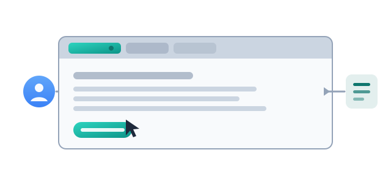

## Install the extension first

This plugin does not launch a browser. It drives the Chrome / Edge you are **already signed in to**. On first use, do these five steps in order; skip one and `mcp__workbuddy__*` cannot reach a browser.

1. **Install and run WorkBuddy.** WorkBuddy ships both the extension and the local relay; DSH only calls into it.
2. **Open WorkBuddy → Settings → Agent → Browser control.** That section is titled "Browser control" and carries a Beta tag.
3. **Press "Install" beside the browser you want to drive, then keep the extension enabled.** The button reads "Installed" once detected. WorkBuddy lists Chrome, Edge and QQ Browser separately, but QQ Browser is unverified on Windows — this plugin only claims Chrome and Edge.
   If the button opens a store page instead of installing, come back and refresh once the install finishes, and confirm the state reads "Installed".
4. **Leave at least one tab open in that browser.** With no page open there is no connection to attach to, and the browser list comes back empty.
5. **Re-enable this plugin in DSH.** Activation probes for `browser-mcp.exe` and for the extension's Native Messaging host, so re-enabling after changing the WorkBuddy install location or upgrading it re-runs that detection.

Once installed, run `mcp__workbuddy__browsers_list` before anything else. A `browser_id` in the result means the path works; an empty array means a step above is still incomplete.

## When it does not work

- **The tools never appear**: WorkBuddy is not running, or `browser-mcp.exe` is not where the plugin looks. The activation diagnostic on this row lists every path it tried.
- **Tools exist but `browsers_list` is empty**: the extension is missing, present but disabled, or the browser has no open tab. Check steps 2–4.
- **Only one browser is missing**: that browser lacks the extension, or is running a different user profile.
- **`provider invocation timed out`**: `browser-mcp.exe` waited 120 seconds for the extension, most often on a tab that has been open for a long time. Refresh that page, or reopen the target URL with `tabs_new`.
- **`tab_not_found`**: `tab_id` values are local to one process and change as tabs open and close. Call `user_open_tabs` again instead of reusing an old id.

## About closing tabs

Both `tabs_finalize` and `tabs_close` close tabs, and `tabs_finalize` does so even when marked handoff on some browsers.

- To keep a page, **call neither**.
- Call `tabs_close` only on tabs the agent opened itself with `tabs_new`.
- A tab taken over with `tabs_claim` is your own: **never** pass it to `tabs_finalize`.
