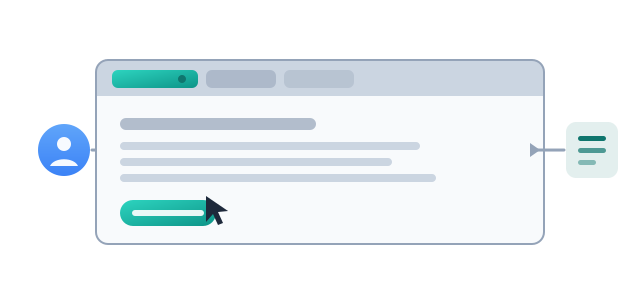

## 装好扩展才能用

这个插件自己不启动浏览器，它驱动的是你**已经登录**的 Chrome / Edge。第一次使用时，按顺序做完这五步；任何一步没做，`mcp__workbuddy__*` 工具都连不上浏览器。

1. **安装并运行 WorkBuddy。** 扩展和本地中继都由 WorkBuddy 提供，DSH 这边只是调用它。
2. **打开 WorkBuddy → 设置 → 智能体 → 浏览器操控。** 这一段的标题就叫「浏览器操控」，带 Beta 标记。
3. **在你要驱动的那个浏览器旁边点「前往安装」，装好扩展并保持启用。** 按钮在识别到已安装后会变成「已安装」。WorkBuddy 会分别列出 Chrome、Edge、QQ 浏览器，但 QQ 浏览器在 Windows 上尚未验证——本插件只承诺 Chrome 与 Edge。
   如果按钮打开的是商店页面而不是直接安装，装完回到这里刷新一次，确认状态变成「已安装」。
4. **在那个浏览器里至少打开一个标签页。** 扩展没有常驻页面就没有可接管的连接；标签页全关掉后，浏览器列表会变空。
5. **回到 DSH，重新开启本插件。** 插件在激活时探测 `browser-mcp.exe` 和扩展的中继宿主名，装在非默认位置或换了 WorkBuddy 版本后重新开启一次即可。

装好之后，第一次调用前先跑 `mcp__workbuddy__browsers_list`。返回里有 `browser_id` 就说明链路通了；返回空数组则说明第 2～4 步还有没做完的。

## 排错顺序

- **工具完全没出现**：WorkBuddy 没在运行，或者 `browser-mcp.exe` 不在插件探测的位置。插件在本行的激活诊断里会写明试过哪些路径。
- **工具有，但 `browsers_list` 返回空**：扩展没装、装了但被禁用、或者浏览器里没有打开的标签页。按上面第 2～4 步检查。
- **只有某一个浏览器不出现**：那个浏览器没装扩展，或者它正在运行的是另一个用户配置。
- **`provider invocation timed out`**：`browser-mcp.exe` 等扩展 120 秒超时，多见于长期挂着的既有标签页。刷新那个页面，或者用 `tabs_new` 重开目标地址。
- **`tab_not_found`**：`tab_id` 是进程局部的，会在标签页增减后变化。重新 `user_open_tabs` 取新的，不要复用旧值。

## 关标签页这件事

`tabs_finalize` 和 `tabs_close` 都会关闭标签页，`tabs_finalize` 即使在部分浏览器上标为 handoff 也照样关闭。

- 想保留页面，**什么都不要调**。
- 只对自己用 `tabs_new` 新建的标签页调 `tabs_close`。
- 用 `tabs_claim` 接管的是你自己原本打开的标签页，结束时**绝不能**传给 `tabs_finalize`。
